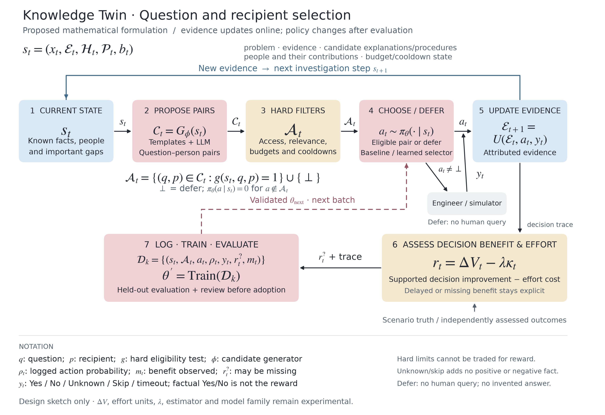

# Question and recipient selection — mathematical design sketch

This figure illustrates the seven-step discussion flow. It is a proposed mathematical formulation, not a selected algorithm, implemented system or measured result. The attached BYOL-style reference supplied the visual direction only; this diagram does not adopt BYOL, EMA encoders or a particular neural architecture.



- [Vector figure](assets/question-policy-diagram.svg)
- [Figure rendering source](assets/question-policy-diagram.py)
- [Design decisions and open experiments](ENGINEERING_DECISIONS.md#d18--bandit-versus-sequential-rl-scope)

## Meaning of the equations

1. **State:** `s_t = (x_t, E_t, H_t, P_t, b_t)`. The current problem/context, attributed evidence, candidate explanations/procedures, relevant people and contribution records, and budget/cooldown state. Evidence is structured source-backed knowledge, not just embeddings. Permissions and other eligibility context are available to the hard filter. Only information available at the decision time enters the policy.
2. **Candidate generation:** `C_t = G_phi(s_t)`. Templates and an LLM propose question–person pairs. Each question has a target fact/link, source-backed rationale and possible decision consequences. Accessible sources and available machine observations are checked before a gap becomes an eligible human query. Generator choice is separate from the selector experiment; phi does not imply RL-training the question-generating LLM.
3. **Hard filter:** `A_t = {(q,p) in C_t : g(s_t,q,p)=1} union {defer}`. Access, relevance, unresolved status, recipient suitability, duplicate suppression and applicable interruption limits restrict the available actions. The policy assigns no probability to excluded actions. Always retain defer, including when the pair set is empty.
4. **Selection:** `a_t ~ pi_theta(. | s_t)`, with support restricted to `A_t`. A deterministic rule baseline is a special case. The first proposed learned comparison is contextual-bandit selection; this notation does not choose a bandit implementation or a sequential RL algorithm. Any exploration is initially simulated, not an authorization to experiment on real engineers.
5. **Evidence update:** `E_(t+1) = U(E_t,a_t,y_t)`. The answer is attributed to a person, question and scope. Yes and No can support or contradict a particular claim; neither is a utility reward. Unknown/Skip/timeout do not add a positive or negative factual observation. Defer delivers no question and fabricates no answer. Interaction metadata and budget state may change without new factual evidence. Rebuild the next investigation state from the revised records and cancel obsolete questions.
6. **Illustrative utility:** `r_t = Delta V_t - lambda*kappa_t`. Delta V denotes independently assessed improvement in the downstream decision; kappa is an effort/interruption cost. Their definitions, units, observation window and tradeoff weight are open. A useful No can yield positive benefit; greater model self-confidence is not the target. A possible controlled evaluator scores the next decision before and after an answer against hidden scenario facts, which never enter the policy input. Real benefit may arrive later or remain unobserved. Observed effort does not establish an unknown benefit; do not impute missing benefit as zero. Error rates, missed opportunities and hard-limit compliance are assessed separately. Hard limits cannot be bought off with a higher reward.
7. **Logging and learning:** store state, candidate/eligible set, action, actual behavior-policy selection probability rho, answer, reward if assessed, and missingness m. `theta' = Train(D_k)` is intentionally algorithm-neutral. Training and evaluation partitions are distinct; split scenario families before creating paraphrases. Offline learning/evaluation needs appropriate coverage, selection logging and missing-feedback handling. Preserve unknown outcomes. Only a candidate that passes held-out evaluation and review may supply a later policy version; the figure does not imply automatic online updates after every answer.

The solid blue feedback path revises knowledge for the next investigation step. The dashed rose path changes the selection policy after a separate training/evaluation cycle. A specialist transformer evidence assessor remains an experiment and is not a required additional node.

## Re-render

With Python and Matplotlib available:

```sh
python docs/assets/question-policy-diagram.py
```

This script renders documentation assets only. It does not implement or run the proposed question policy.
