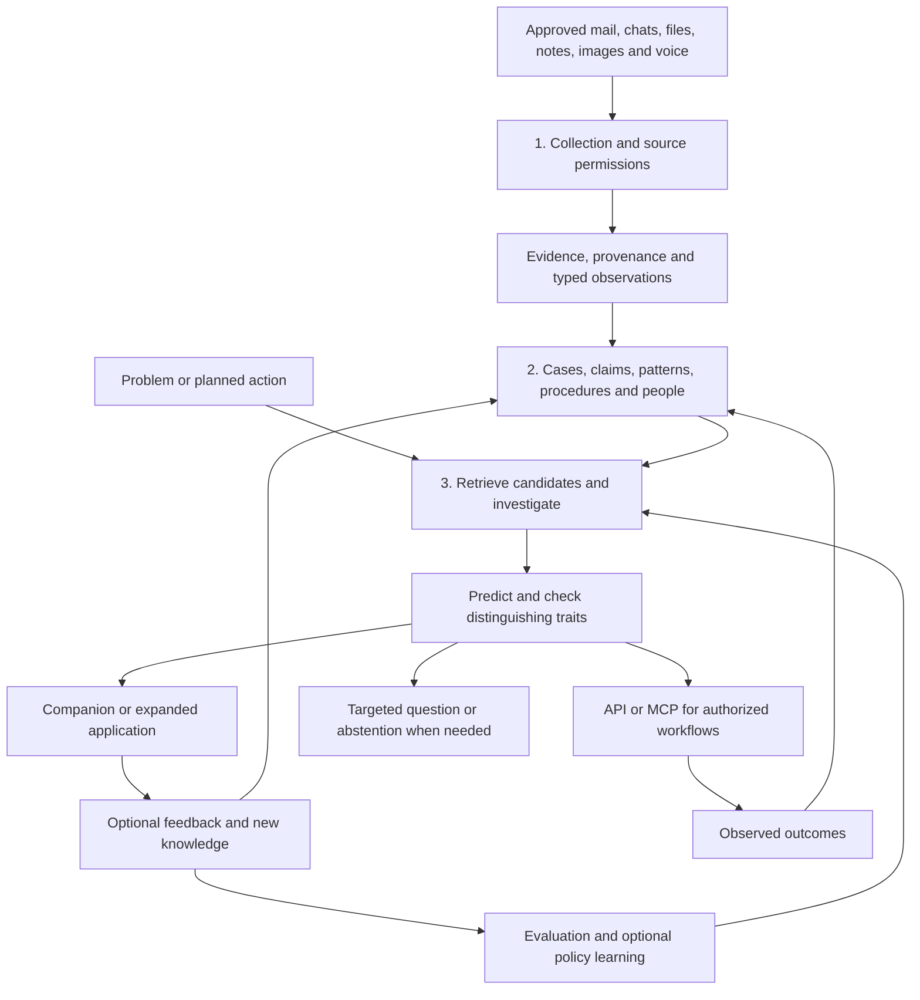

# Knowledge Twin — current vision and design rationale

**Since AI Hackathon 2026 · Elisa challenge · Working design, 6 November 2026**

Knowledge Twin would turn scattered operational experience into evidence-backed context that people and automated workflows can use when a problem appears or an action is being considered. It would collect approved material, connect it to cases and equipment, preserve how explanations changed, and check whether earlier solutions apply to the present situation.

The central idea is to **capture knowledge once and make it useful repeatedly**, with less expert effort on recurring situations. A small desktop companion makes contributing and asking easy. The same knowledge service also serves external agents.

**Status:** this is a detailed design handoff, not a description of a completed implementation. This documentation update does not implement connectors, train models, ingest private data or operate equipment. Proposed schemas, tools, example outputs and milestones below are illustrative until implemented and tested.

## Latest decisions after the information session

This section records the current direction for the team; the detailed sections below explain the mechanisms.

- **Usability leads the demo.** The supplied official brief prioritizes capturing useful context with minimal additional expert work. Artem reports that the information session explicitly accepted quick Yes/No questions while discouraging forms and elaborate feedback. Reuse existing conversations first; questions should fill consequential gaps.
- **Evidence-backed claims inside cases.** A case remains the incident container. Each claim carries its own sources, support, contradictions, equipment/context and validity. A reported recovery is different from a verified lasting recovery or a proven cause.
- **Electron is the desktop application framework.** Both the compact companion and the expanded application are intended to run through Electron on macOS and Windows. The shared service can run on organization-controlled infrastructure. This repository does not yet contain a working desktop app or tested platform builds.
- **Default avatar: a white pixel circle with a small face.** Dark pixel eyes, a tiny mouth and pink cheeks; animation comes later. See the [static avatar asset](assets/avatar-default.svg) and its preview in the [master map](master-map.html).
- **Optimize useful assistance and restraint together.** Measure whether the knowledge helped, unnecessary interventions, missed useful opportunities and expert effort. Counting MCP calls or positive clicks alone is insufficient.
- **Questions are distributed; coordination is shared.** One service chooses a useful question, an eligible engineer and suitable timing, with a defer/no-question option. It learns from outcomes without broadcasting every uncertainty to everyone.
- **Binary feedback and optional points stay.** Yes/No answers retain their specific meaning; unknown/skip/later remain available. Points can be toggled off and do not determine factual confidence or the model's reward.
- **Learning starts with a measurable baseline.** Use supervised classification/linking where appropriate, then evaluate a contextual bandit for question or recommendation selection. Sequential RL remains an option for multi-step investigations once the environment, reward and evidence justify it.

## Start here

- [Documentation index](README.md): entry point for teammates and agents.
- [Experience and points brief](EXPERIENCE_BRIEF.md) and [pitch-film brief](PITCH_FILM_BRIEF.md): dedicated design and production handoffs.
- [Technical discussion guide](TECHNICAL_DISCUSSIONS.md): start a fresh session with the latest clarifications, ten focused technical topics and copyable discussion prompts.
- [Workstreams and delegation plan](WORKSTREAMS.md): ten clear problems, bounded agent assignments, dependencies, technical decisions and the four-problem pitch.
- [Interactive master architecture map](master-map.html): current post-session design, five connected maps, claim schema, learning loops and a case walkthrough. Open the downloaded HTML in a browser; it works offline.
- [Architecture reference](ARCHITECTURE.md) and [engineering decision queue](ENGINEERING_DECISIONS.md): current component contracts and 18 algorithm, metric and implementation discussions. These refine the earlier vision below.
- [BRIEF.md](BRIEF.md): supplied challenge text, interpretation, scope, demo objectives and questions for Elisa.
- This vision document: product direction, architecture, rationale, tradeoffs, learning approach and implementation sequence.
- [RESEARCH.md](RESEARCH.md): earlier research comparing several hackathon challenges. Its original approval-heavy OpsMemory sketch is historical context; the design below develops it further.
- [docs/INITIAL_CONCEPT.md](INITIAL_CONCEPT.md): preserved earlier repository proposal and judge Q&A. Some answers describe intended behavior as if already built and contain unverified model, pricing and demo claims. Treat them as preparation material, not evidence of implementation.

The repository already used **Knowledge Twin**. Earlier discussion used **OpsMemory** for the operational-memory idea. The final name is open. References to “MemOps” in the conversation concerned that memory-management concept; we have not selected a library called MemOps or MemOS.

### Reading paths

- **Product overview:** [the product](#1-the-product-we-are-trying-to-build), [three mechanisms](#2-three-mechanisms-one-shared-memory), [minimal UI](#15-minimal-ui-expandable-history).
- **Data pipeline:** [collection modes](#3-collection-historical-manual-and-continuous), [email imports](#4-moving-old-email-without-an-enterprise-connector), [deduplication and sync](#5-deduplication-threading-and-incremental-updates), [screen capture](#6-screen-understanding-useful-but-a-limited-fallback).
- **Intelligence:** [memory records](#7-what-the-memory-contains), [case creation](#8-how-a-case-is-created-and-updated), [Flash-Lite](#9-where-gemini-flash-lite-fits), [hypothesis checks](#10-retrieval-followed-by-hypothesis-testing), [memory lifecycle](#11-memory-operations-and-retrieval-are-different-jobs).
- **Learning and participation:** [feedback and RL](#12-feedback-learning-and-rl), [questions and points](#13-questions-and-points-without-making-work-compulsory), [people](#14-people-identity-and-contacting-an-expert).
- **Autonomy and delivery:** [adaptation and autonomy](#16-adaptation-and-autonomous-operation), [hosting/privacy](#17-organization-controlled-deployment-and-privacy), [architecture](#18-a-realistic-first-architecture), [MCP](#19-mcp-and-autonomous-consumers).
- **Build and pitch:** [prototype phases](#20-hackathon-prototype-and-demonstration-sequence), [evaluation](#21-evaluation-prove-the-mechanism-earns-its-complexity), [decision rationale](#22-design-rationale-and-how-the-vision-evolved), [open decisions](#23-open-decisions-for-the-team).

### What is established, and what is still a proposal?

| Area | Current position |
| --- | --- |
| Three mechanisms | Keep collection, memory organization and problem-solving distinct, with explicit interfaces. |
| Generality | Support different sources and domains, including local notes and images; avoid tying the product to one chat platform. |
| Collection modes | Manual contributions, explicitly activated continuous capture/synchronization, and authorized historical backfill. |
| Hypothesis checks | Central to the vision: retrieve candidates, predict additional traits, then test applicability. |
| User experience | Electron desktop app for macOS and Windows: compact input, white pixel-circle avatar, optional OS entry point and expandable problem-to-solution history. Platform builds are not yet implemented/tested. |
| Feedback | Simple Yes/No is valid; users choose how much they contribute. A 1–5 usefulness rating remains an optional experiment. |
| Points | Include an on/off demonstration option; reward useful participation without making agreement with the model profitable. |
| Autonomy | Adaptation followed by autonomous reuse for supported situations, with ongoing handling of exceptions. |
| Hosting | Organization-controlled infrastructure is a first-class requirement; model processing location is a separate choice. |
| Models | Gemini API access is available. Flash-Lite is a proposed frequent-use extraction/phrasing model; exact version and alternatives are unselected. |
| Learning | Collect meaningful feedback from the start. Whether to train a classifier, ranker, bandit or sequential RL policy depends on the decision and available data. |
| Implementation | GCP containers, object storage and PostgreSQL with vector search are a proposed practical starting point, not a locked stack. |
| MCP | A useful interface to the shared service, potentially including a learned policy. Tool contracts are still drafts. |

## 1. The product we are trying to build

An engineer should be able to paste a problem, drop a screenshot, or allow an approved incident feed to provide a new event. The system should answer:

1. What historical situations might be relevant?
2. What matches, what differs, and what is still unknown?
3. If a historical explanation applies, what additional observations should we expect?
4. Which observation would best distinguish the alternatives?
5. What response previously helped, under which conditions, and with what evidence?
6. Who contributed relevant knowledge, if that information may be shared?
7. What can an authorized downstream workflow do with this context?

The same system should accept an old email thread, a technician's local note or an explanation remembered later. It should connect that contribution to the right case, update the historical account and make the new knowledge retrievable.

There are two equally useful entry points: **“Help with this problem”** and **“Here is something worth remembering.”** Neither requires the person to fill out a long incident form.

The earlier repository concept also proposed an action-oriented query: **“What should an agent know before doing this to this device?”** Keep that capability. Historical solutions and operational constraints belong in the same evidence model, even though their retrieval questions differ.

## 2. Three mechanisms, one shared memory



Collection is an independent mechanism. It needs source adapters, authorization, filtering, backfill, incremental updates and deletion handling. Drawing it as one box does not mean those problems are solved.

Memory organization decides what an item means and how it relates to other evidence. Assistance decides what information is relevant to the present decision. Keeping these responsibilities separate lets us improve collection without rewriting investigation, or add a new UI without creating another memory store.

Access control, retention, auditability and model-provider policy apply across all three mechanisms.

## 3. Collection: historical, manual and continuous

### 3.1 Manual contributions

The person can paste text, paste or drag an image, upload a file, share selected messages, or give a short voice explanation. They may select an existing case, but that should not be compulsory.

After parsing, the system can suggest: “Does this relate to the authentication incident?” with **Yes / No / Skip**, or offer two plausible cases and **Neither / New case**. A contribution can concern several incidents, so linking should work at passage or observation level rather than forcing an entire document into one case.

The correction supplies useful training data: this evidence belongs to case A, does not belong to case B, or requires a new case. A No for A does not automatically mean Yes for B.

### 3.2 Historical backfill at onboarding

The first-run experience can customize the avatar and its name, the user's display name and optional contact handle, question preferences and points. It should also establish the organization/workspace and its allowed storage and processing destinations.

Then offer historical import. The user or administrator selects sources, dates, folders/channels and visibility. Once that scope is authorized, the backfill can run automatically, show progress, deduplicate and resume after interruption.

“Automatic retrieval when you start” means automated processing of an approved scope. It does not mean scanning all local files or mailboxes merely because the application launched.

### 3.3 Continuous collection

Continuous mode is an explicitly enabled source subscription or capture session. Prefer structured source events, file changes and accessible text over repeated screenshots where possible.

The user should see which sources are active, where data goes and how to pause. Use source allowlists, sensible batching, change detection, local/private filtering where feasible, and a clear retention policy. Source authorization and organizational policy still apply even when a person can see the material on their screen.

The system can recognize useful new information and award contribution credit without interrupting after every message. It should not reward leaving capture active, uploading more pixels or repeatedly sharing the same content.

### 3.4 Recovering unwritten context

A case provides the prompt for a small contribution:

> “The discussion ends after the restart, but the incident is marked resolved. Do you remember what finally fixed it?”

The person can answer in text or voice, attach evidence, or skip. This is more focused than asking everyone to write documentation from scratch. The explanation becomes attributed evidence, with its own date and uncertainty, rather than a silently verified root cause.

Collection design remains open in several areas: which continuous source to support first, how to filter relevance before external inference, the exact review experience and how to handle unavailable historical permissions.

## 4. Moving old email without an enterprise connector

There is no single requirement that “Google access needs a paid company license.” Personal Gmail, organizational Gmail policy, custom OAuth applications and third-party connector subscriptions are different issues.

| Method | Best fit | Authorization and constraints | Tradeoff |
| --- | --- | --- | --- |
| MBOX export | Bulk historical import, including Gmail Takeout where available | Account holder initiates export; organizational policy may restrict it | Portable snapshot with message structure; subsequent changes require another import or connector |
| EML files | Selected messages or a small case-specific collection | User exports permitted messages from a supporting mail client | Easy hackathon input; manual selection may omit part of the history |
| Standard IMAP | Mail providers that permit client access and ongoing synchronization | Provider-supported authentication, account access and organizational allowance | Broad compatibility; folder/label duplication and synchronization state require care |
| Gmail API | Structured Gmail import and incremental updates | Google Cloud project, enabled API and user OAuth; production requirements depend on scopes and deployment | Strong identifiers and history support; OAuth review is a separate productization task |
| Microsoft Graph | Supported personal Microsoft and organizational mail accounts | Delegated scopes for the signed-in user; tenant policies may require administrator approval; application permissions are separate | Structured messages and incremental mechanisms, with different account/tenant restrictions |
| Enterprise archive | Organization-controlled historical or compliance records | Authorized archive/eDiscovery roles, appropriate licensing and approved export scope | Useful if the organization already has it; not a universal startup dependency |
| Explicit screenshot/OCR | A selected fragment with no useful export route | Permission to share or capture the visible material | Low completeness and weak metadata; unsuitable as the main mailbox import mechanism |

### Personal Gmail and organizational Gmail

Google documents mail export and individual-message download. A Gmail API quickstart requires a Google Cloud project and a Google account with Gmail enabled; a paid Workspace organization is not a blanket prerequisite. Work/school accounts may have administrator restrictions that personal accounts do not. Exporting data does not itself grant permission to share all correspondents' information with a new service. Sources: [Gmail export](https://support.google.com/mail/answer/10016932?hl=en), [Google Takeout](https://support.google.com/accounts/answer/3024190?hl=en), [EML download](https://support.google.com/mail/answer/9261412?hl=en), [Gmail API quickstart](https://developers.google.com/workspace/gmail/api/quickstart/python).

For an external Google OAuth app in Testing, Google currently documents up to 100 listed test users and seven-day authorization expiry for scopes beyond basic identity, including corresponding offline refresh tokens. Organizational account restrictions can still block access. That makes a small authorized experiment feasible but is not a complete production onboarding plan. Source: [Manage App Audience](https://support.google.com/cloud/answer/15549945?hl=en).

`gmail.readonly` is a restricted scope. Public production applications may require verification; restricted-scope data stored or transmitted through servers can bring security-assessment requirements, subject to the documented exceptions. A read-only connector should request the least access it needs. Sources: [Gmail scopes](https://developers.google.com/workspace/gmail/api/auth/scopes), [restricted-scope verification](https://developers.google.com/identity/protocols/oauth2/production-readiness/restricted-scope-verification).

### IMAP and archives

For personal Gmail, Google documents IMAP as always enabled from January 2025 and recommends modern Google sign-in. Work/school behavior is subject to administrators. A custom Gmail IMAP OAuth integration uses the broad mail scope; IMAP is not a way around Google's OAuth requirements. Do not make users hand over their normal password; app-password availability is account-dependent and should not be our default. Sources: [Gmail client access](https://support.google.com/mail/answer/7126229?hl=en), [Gmail IMAP OAuth](https://developers.google.com/workspace/gmail/imap/xoauth2-protocol).

Microsoft Graph supports delegated `Mail.Read` for personal accounts, while organizational consent and application access have their own controls. Sources: [Graph Mail.Read](https://learn.microsoft.com/en-us/graph/permissions-reference#mailread), [organizational consent policies](https://learn.microsoft.com/en-us/entra/identity/enterprise-apps/manage-app-consent-policies).

Google Vault and Microsoft Purview are possible organizational export sources when authorized and licensed. Their coverage depends on configured retention, holds and supported data; an archive cannot be assumed to contain everything forever. Sources: [Vault overview](https://knowledge.workspace.google.com/vault/getting-started/vault-overview?hl=en), [Purview eDiscovery](https://learn.microsoft.com/en-us/purview/edisc-features-components).

### Preserve structure and acknowledge gaps

Parse MIME rather than flattening a whole mailbox into one text file. Preserve available sender/recipient fields, message IDs, reply references, provider thread IDs, date/timezone, folder/labels, attachments and source provenance. Keep original material or an authorized reference according to retention policy.

An export is a snapshot of available selected data. Permanently deleted items, inaccessible linked documents and messages outside the scope may be missing. Encrypted content remains inaccessible without appropriate keys. A screenshot does not prove that hidden replies or attachments were included. Record import scope and known omissions so “no evidence found” does not become “this never happened.”

For the hackathon, implement file import first using synthetic or approved EML/MBOX and text. Add a live mailbox connector only if it helps the demonstration enough to justify its authentication and privacy work.

## 5. Deduplication, threading and incremental updates

These are core correctness requirements: ten copies of one claim must not become ten independent confirmations.

| Concern | Proposed handling |
| --- | --- |
| Exact duplicates | Use account/source-scoped provider IDs, then message IDs plus content fingerprints where appropriate. Keep provenance for each authorized occurrence. |
| Quoted replies | Separate newly authored passages from quoted history. Preserve the relationship but avoid counting the quotation as new corroboration. |
| Email threads | Prefer provider thread IDs and `In-Reply-To` / `References`; use subject matching only as a weaker fallback. |
| Missing or reused IDs | Combine content, dates and source context conservatively. Do not overwrite a changed message merely because a header matches. |
| Screenshot repetition | Detect overlapping or unchanged content; retain capture time separately from the original event time. |
| Cross-platform continuation | Use incident IDs, assets, chronology and verified identity mappings. Similar wording alone is not enough to merge cases. |
| Repeated imports | Make import jobs idempotent and resumable. Keep import versions and scope. |
| Permission differences | Deduplication must not broaden access. Keep restricted provenance separate and build answers from evidence the caller may use. |

For live synchronization, persist the provider's cursor and recover correctly when it becomes invalid. Gmail uses history IDs and may require full synchronization when history is no longer available. Microsoft Graph message delta is folder-scoped. IMAP UIDs are meaningful with their mailbox and UIDVALIDITY. Sources: [Gmail sync](https://developers.google.com/workspace/gmail/api/guides/sync), [Graph message delta](https://learn.microsoft.com/en-us/graph/api/message-delta?view=graph-rest-1.0), [IMAP standard](https://www.rfc-editor.org/rfc/rfc9051.html), [email reply headers](https://www.rfc-editor.org/rfc/rfc5322.html#section-3.6.4).

An item absent from a later partial export is not necessarily deleted. Source deletion, access revocation and retention expiry need explicit handling: remove or restrict affected evidence, recompute dependent claims, refresh indexes and prevent a stale cached answer from exposing it. Backups and audit records need a documented lifecycle too.

## 6. Screen understanding: useful, but a limited fallback

The original idea of a model continually transcribing visible screen content is technically useful for some workflows, especially where structured interfaces are missing. It is not a complete historical collection method.

- It sees only what was visible during capture, not unopened messages, hidden replies or unseen attachments.
- OCR can corrupt equipment IDs, numbers, error codes and negation. A visual model can also infer more than the image supports.
- The image may lack author, thread, source URL, original timestamp, permissions and context.
- Repeated frames create duplicates and unnecessary processing cost.
- A window may expose unrelated personal information, credentials or confidential material.

Start with **explicit screenshot sharing**. If continuous screen capture is later demonstrated, make it scoped, visible, interruptible and governed by the same source rules as other collection. Prefer local change detection and filtering before approved model inference. Mac screen-recording permission is necessary for applicable capture mechanisms, but OS permission alone is not authorization to retain or republish every visible conversation. See [Apple's screen-recording privacy controls](https://support.apple.com/en-au/guide/mac-help/mchl211c911f/mac).

For images, store separate fields for extracted text, directly observed visual features and model interpretations. Keep an authorized reference to the original so a person can check an exact error message. Redaction reduces exposure; it is not a guarantee that all personal or sensitive content has been removed.

## 7. What the memory contains

The central record is a **case**, but the memory is richer than a cluster of embeddings and one associated answer.

| Record | Purpose | Example |
| --- | --- | --- |
| Evidence item | Original source or permitted reference, provenance, access rules and extracted passages | An email, screenshot or voice explanation |
| Observation/event | Something reported, observed, attempted or measured, with time and source | “Restart restored service for 20 minutes” |
| Claim | A typed assertion with support, status and applicability | “This restart was a temporary workaround” |
| Case | One incident's context, timeline, hypotheses, attempts and outcomes | Authentication incident on device X on a particular date |
| Pattern | A recurring relationship across separate cases | Authentication failures associated with credential expiry |
| Procedure | A reusable response with preconditions, evidence and verification | Approved recovery procedure for a compatible environment |
| Entity | Equipment, site, software, service or person | Device X, firmware family Y, service owner |
| Relationship | A qualified link between records | Supports, contradicts, supersedes, attempted, contributed to |
| Feedback event | A person's answer about a specific displayed decision | “No, this screenshot belongs to a different incident” |

Cases can have several candidate explanations. A pattern can have several responses, and one response can apply to several patterns. A cluster is useful for retrieval and discovery but is not proof of one shared cause.

### Minimal case contents

- Identifier, title, current status and access scope.
- Original problem description and normalized searchable description.
- Assets, environment, versions, time range and unresolved entity mappings.
- Evidence references and event chronology.
- Hypotheses with supporting, contradicting and missing observations.
- Actions attempted and their reported or observed outcomes.
- Resolution, if known, with its evidence and limitations.
- Related incidents, recurring patterns and applicable procedures.
- Case-specific contributions by people.
- Extraction/model version, revision history and last review/revalidation information.

Separate **open**, **outcome unknown**, **reported resolved but explanation missing**, and **resolution documented**. A closed ticket does not prove a particular cause. A claim can be suggested, reported, corroborated, contradicted, superseded or confirmed under a defined evidence policy; do not equate an LLM's confident phrasing with confirmation.

### Operational constraints from the earlier concept

Retain typed constraints such as a required precondition, approval requirement, temporary warning or action restriction. A claim can include its validity interval and the equipment/action it concerns.

Enforcement belongs to explicit organization policy and the authorized executor. An extracted message cannot invent authority to block, approve or execute an operational action. Conversely, an unconfirmed warning about a serious risk should not be automatically ignored because it lacks a second message: policy may pause and escalate uncertainty.

## 8. How a case is created and updated

1. **Register the evidence.** Assign a stable ID, record source scope and access, preserve an allowed original/reference, and distinguish event time from ingestion time.
2. **Extract structured observations.** Parse text/images and identify observations, hypotheses, attempts, outcomes, entities and source spans. Unknown fields remain unknown.
3. **Retrieve candidate cases.** Combine semantic similarity with exact incident IDs, assets, time, software versions and existing source-thread links.
4. **Decide the relationship.** Automatically link well-supported matches; keep ambiguous links provisional, offer a small choice, or create a new case. A reviewer can correct the proposal.
5. **Reconcile the history.** Add the new observation without erasing the earlier account. Detect contradictions, partial outcomes and possible supersession.
6. **Update derived views.** Refresh the readable summary, timeline, relationship records and retrieval indexes. Preserve extraction/version provenance so derived data can be regenerated.
7. **Identify a useful gap.** If an important missing fact is worth asking about and the user's question budget allows it, ask one focused question. Otherwise retain the gap.

**Same incident** and **same kind of problem** are different predictions. A conversation continuing in another application may belong to the same incident. A similar fault on another day is usually a separate case connected by a pattern. False merges destroy chronology and can misattribute people's actions, so similarity alone must not merge histories.

### Example: an incomplete history becoming useful

All identifiers and observations here are fictional illustrations.

| Evidence received | What enters the case | What must remain uncertain |
| --- | --- | --- |
| Screenshot: device X shows authentication error E17 | Observed error, device candidate and image reference | Cause and original event time if not visible |
| Chat: “Restarting brought it back” | Attempted restart and reported recovery | Whether recovery lasted or why it worked |
| Later message: “It failed again after 20 minutes” | Recurrence; earlier success qualified as temporary | Final explanation |
| Engineer: “Replacing the expired credential fixed it” | Attributed resolution report and credential hypothesis | Scope of verification unless logs or follow-up establish it |
| Follow-up: approved telemetry shows stable operation over the observation window | Additional outcome evidence and window | Whether the result transfers to a different version/environment |

The resulting history contains a temporary workaround, a later resolution and their evidence. It should not compress everything into “restart fixes E17.”

For cases with no documented ending, provide **“I know how this was solved.”** Text, voice or attachments produce a draft resolution that can be corrected and attributed. Useful completion earns contribution credit when points are enabled.

## 9. Where Gemini Flash-Lite fits

Yes: Flash-Lite is a reasonable candidate for forming the initial structured account and readable problem-to-solution chain from supplied material. It can also phrase a problem more clearly, classify passages, propose entities and relationships, generate concise questions and draft role descriptions.

Use it frequently for bounded tasks, with schemas and source references. It proposes an interpretation; application logic validates structure, enforces permissions and decides which state transitions are allowed.

| Task | Proposed model role | Required application behavior |
| --- | --- | --- |
| Normalize a pasted problem | Produce clearer text without changing meaning | Preserve original wording, exact IDs and uncertainty |
| Parse an image | Extract visible text and relevant visual observations | Keep image provenance; flag unclear text and unsupported inference |
| Build a timeline | Extract events and their relationships | Distinguish source time, event time and inferred order |
| Link evidence to cases | Score or explain candidates after retrieval | Validate exact identifiers and keep ambiguous links reversible |
| Form a solution chain | Summarize hypotheses, checks, attempts and outcomes | Leave gaps and failed branches visible; attach evidence references |
| Describe a contribution | Draft “You tested hypothesis A in this case” | Allow Confirm / Edit / Not me; avoid permanent role inference |
| Phrase a follow-up | Ask a concise distinguishing question | Respect question budget, permissions and current evidence |

The chain is an **evidence and action history**, not a transcript of private model reasoning. It can contain branches, conflicting accounts and unknown transitions. Do not fabricate a clean story just because the UI expects one.

Keep both original and normalized problem descriptions: “maybe after the update” must not become “caused by the update.” Generate embeddings with a dedicated embedding model and record its version. Changing embedding spaces requires a compatible migration/reindexing plan.

Model output matching a JSON schema does not establish semantic truth. Use stronger models or human review selectively for difficult interpretation if evaluation justifies the extra cost. Exact model version, available modalities, quotas and pricing should be checked in the team's account before implementation. Sources: [Gemini structured output](https://ai.google.dev/gemini-api/docs/structured-output), [Gemini embeddings](https://ai.google.dev/gemini-api/docs/embeddings).

## 10. Retrieval followed by hypothesis testing

Artem's prediction idea is central to the product. Candidate retrieval is the beginning of investigation.

### Proposed investigation sequence

1. Accept a manual problem or an authorized source event.
2. Normalize it while preserving original evidence and uncertainty.
3. Retrieve candidates with semantic search, exact keywords/IDs and environment filters.
4. Rank the candidates by relevant evidence and applicability, including version and known failed attempts.
5. For each credible candidate, state what additional observations should be expected if its explanation applies.
6. Check available authorized logs, configuration, asset metadata and conversation evidence. Ask a person only for a valuable gap the system cannot resolve itself.
7. Update support when predictions match, fail or remain unknown.
8. Present the best-supported options, an appropriate response or a distinguishing next check. Return structured context to the external workflow when requested.
9. Record subsequent observations and optional feedback.

Usually show up to two or three credible alternatives, with **none fits / insufficient evidence** available. Do not invent extra alternatives merely to fill the interface.

### What counts as additional evidence?

Suppose “authentication error” was used to retrieve the historical case. Observing the same phrase again is not a new successful prediction. A more useful prediction might be: “If expired credentials explain this failure, the credential validity check should fail while the relevant connectivity check remains normal.” Whether those traits are appropriate must come from domain knowledge or sourced cases, not an invented universal rule.

Record proposed distinguishing traits before evaluating newly obtained or held-out evidence. In retrospective evaluation, hide later resolution information until the simulated point where it became available. This reduces circular confirmation.

| Check state | Meaning |
| --- | --- |
| Observed match | New evidence supports this prediction to the extent it distinguishes the candidate |
| Contradiction | Evidence conflicts with the candidate or its applicability |
| Unknown | The observation is unavailable; it is neither success nor failure |
| Not applicable | The proposed check does not make sense in this environment |

Two language models agreeing on an explanation are not two independent observations. A quoted message and its original are also not independent evidence.

### Choosing the next check

Prefer checks that could change the next action, separate plausible candidates and are cheap to obtain. A useful conceptual objective is:

> Choose the permitted check with the greatest expected improvement in the decision, after accounting for effort, delay and interruption cost.

The earlier “duality-style optimization” idea can be explored as a constrained objective: improve recommendation quality subject to limits on expert burden, cost and authorized actions. A Lagrange multiplier could express a tradeoff mathematically. This is an optional formulation, not a claim that retrieval and verification are already a formal primal–dual pair or that a specific optimization algorithm has been selected.

### Confidence and transparency

Show what matched, what contradicted the candidate and what remains unchecked. Initially use descriptions such as **supported by these observations; one important condition unknown**. If displaying a numeric score, label whether it is a heuristic ranking score or an empirically calibrated probability.

A vector similarity of 0.8 is not an 80% chance that the same cause applies. “Same incident,” “same cause” and “solution likely to help” are different quantities. Percentages should come from evaluation on suitable held-out cases, with reliability checked rather than assumed. [Calibration research](https://proceedings.mlr.press/v70/guo17a.html) explains why model confidence needs empirical assessment.

## 11. Memory operations and retrieval are different jobs

RAG retrieves relevant material for a model. The memory service also maintains the meaning and validity of that material over time.

Its responsibilities include adding evidence, proposing relationships, revising hypotheses after test results, marking disproven or superseded explanations, promoting sufficiently supported responses into procedures, and reconsidering procedures after equipment/software changes.

Example: Monday's “restart fixed it” becomes Tuesday's “restart was temporary” and Wednesday's “damaged connector was reported as the lasting cause.” All three events remain understandable, but future recommendations use the current supported interpretation.

Revalidation should reflect the type of claim. An access code location may become stale quickly; a documented historical event does not become false simply because nobody mentions it again. Explicit validity dates, environment changes and contradictions are stronger signals than indiscriminate time decay.

Source deletion and permission changes must propagate to derived knowledge. Store dependencies so a claim supported only by removed evidence can be retracted or withheld, while other independently supported claims can be recomputed. Do not retain a prohibited personal detail merely because it has become an embedding or summary.

## 12. Feedback, learning and RL

### Binary feedback is sufficient for many decisions

The user can answer **Yes / No**. We do not need a long feedback form. The system records which question and decision the answer concerns.

| Question | What a Yes labels | What a No labels |
| --- | --- | --- |
| “Does this item belong to this case?” | Positive evidence-to-case link | Negative link for that candidate |
| “Is this the same kind of problem?” | User-confirmed similarity under the stated context | Rejected proposed relationship |
| “Did this suggestion help?” | Reported usefulness | Reported lack of usefulness |
| “Did this resolve the problem?” | Reported resolution | Reported non-resolution |
| “Was this person's contribution useful?” | Useful referral/contribution in this context | Unhelpful referral/contribution in this context |

We do not ask all these questions after every interaction. Choose the relevant one, retain its wording and context, and distinguish a skipped answer from No. “Helped” and “resolved” can both be binary without becoming interchangeable labels.

### Binary versus 1–5

The proposed default is binary for low-effort feedback and factual relationship checks. A 1–5 usefulness rating could be offered in expanded review when people want to express degree: 1 not useful, 3 somewhat useful, 5 very useful.

This remains an experiment. A five-point rating creates more nuance and more effort, and people may interpret its intervals differently. Do not treat it automatically as a correctness probability or mix it with resolution labels without an explicit model of what it means.

### Match the learning method to the decision

| Decision | Practical first approach | Possible later learning |
| --- | --- | --- |
| Does evidence belong to a case? | Candidate retrieval plus rules/model scoring | Supervised classifier or pairwise ranker trained on confirmed links |
| Which past solution to present? | Evidence-aware ranking with eligibility checks | Learned reranker or contextual bandit |
| Which useful question to ask next? | Heuristic information/decision value and effort budget | Bandit; sequential RL if actions materially affect later states |
| When to interrupt or abstain? | Explicit thresholds and policy | Learned policy with false-interruption and error costs |
| How to phrase the answer? | Prompted foundation model | Separate preference evaluation or fine-tuning if needed |

RL is a legitimate direction, especially for a sequence of diagnostic decisions. It is not required merely because feedback exists. A model predicting whether two records belong together can learn from binary labels through supervised training. A bandit can optimize a recommendation choice without modeling a long investigation trajectory.

The practical proposal is to instrument the feedback loop first, establish a baseline, then train the smallest useful policy. Calling a foundation-model API with feedback in the prompt does not automatically train its weights. If the hackathon only records feedback, present that honestly as preparation for learning.

### The main objective: useful assistance with appropriate restraint

The product objective is **more useful decisions from existing knowledge, with fewer unnecessary interruptions and less expert effort**. This is a proposal to evaluate, not a claim that the current system has learned it.

Start by defining an **eligible opportunity**: a user problem query, an agent's authorized context request, or an authorized incident event at which the service could supply context or abstain. Evaluate user-requested assistance and proactive interruptions separately. Deduplicate retries and repeated calls within the same decision so traffic volume does not inflate success.

| Metric | Proposed definition | Why it is needed |
| --- | --- | --- |
| Useful assistance per 100 eligible opportunities | Distinct opportunities with a supported helpful intervention / all eligible opportunities in a fully labeled evaluation set | Rewards useful coverage; repeated reads of one claim do not create extra successes |
| Recommendation usefulness | Helpful recommendations / recommendations whose usefulness was assessed | Measures precision, with assessment count and feedback coverage reported alongside it |
| Unnecessary intervention rate | Proactive offers judged unnecessary / assessed proactive offers; also report unnecessary offers per 100 eligible events | Captures disruption; a wrong recommendation and a correct but irrelevant interruption can both be unhelpful |
| Missed useful opportunities | Opportunities with useful available knowledge where the policy failed to offer it / all such labeled opportunities | Prevents an always-silent policy from appearing excellent |
| Expert burden | Questions and active answering time per incident, plus per-person load | Makes minimal administrative work an explicit constraint |
| Errors and outcome support | Unsupported/inapplicable advice, reported help, reported resolution, measured recovery and recurrence | Keeps factual dependability separate from popularity |

For the first comparison, use a held-out synthetic scenario set with known useful/irrelevant cases and hidden answers, then add independently reviewed examples. In a real pilot, unanswered interactions have unknown usefulness. Do not silently count them as failures, successes or unnecessary interruptions; report response coverage and audit a sample that includes abstentions. Report numerator, denominator, scenario mix and uncertainty, not just a percentage.

**Proposed optimization target:** maximize supported useful interventions per eligible opportunity, subject to agreed limits on inapplicable advice, unnecessary proactive interruptions and expert burden. Track missed opportunities alongside those limits. Fix the evaluation population and compare with vector-only retrieval and a simple threshold/rule policy. Choose numerical thresholds and any reward weights from that comparison rather than inventing them now.

### MCP use, human feedback and outcomes are different signals

| Event | What we may infer | What we cannot infer from it alone |
| --- | --- | --- |
| MCP returns a claim | The agent received/exposed itself to that context | The agent used it or found it useful |
| Agent records that the claim influenced its answer or plan | Agent-reported adoption, with a trace and claim IDs | The advice was correct or improved the outcome |
| User answers Yes to “Did this help?” | Human-reported usefulness for that recommendation | Lasting resolution or proven root cause |
| Authorized workflow reports an action and relevant outcome measurements | Observed behavior/result over the stated window | That this knowledge alone caused the result |
| Follow-up shows recurrence | The earlier success may have been temporary | Every part of the earlier advice was false |

An agent can submit useful feedback through MCP. Store the reporter type, source, question wording, decision ID, case/claim versions and evidence references. Treat its self-rating as a distinct signal and audit it; an agent rewarding its own generated advice is not independent validation. Human and agent judgments can disagree without one overwriting the other.

Use an event progression such as `context_returned → context_used_reported → action_reported → outcome_observed`, with optional human helpfulness feedback. These events may be missing or arrive out of order. Link them by decision/trace ID rather than assuming that every read led to an action. A successful retrieval is a retrieval metric, not yet a successful operational intervention.

Repeated helpful reuse may improve a recommendation's estimated usefulness **within the relevant conditions**. It must not turn a popular claim into a universally true one. Deduplicate sources and decisions; count genuinely separate outcomes separately from copies or retellings of one event. A useful precaution can prevent a bad action without resolving a fault, so outcome labels depend on the task.

### Rewards and logging

For “Did this recommendation help?”, Yes can be reward 1 and No reward 0. For “Did the fault recur?”, Yes/No is a factual observation; either answer can make asking the question useful. A rejected case link is a negative supervised label for that link, not automatically a penalty for the policy that asked for clarification.

The question policy needs its own outcome: did the answer provide new supported information that changed or justified a consequential decision, or avoid unsuitable advice? Test this against hidden scenario truth or independent review. A drop in the model's self-reported uncertainty is only a proxy and can reward becoming confidently wrong. Avoid extra rating questions after every factual question; reuse subsequent evidence and assess samples offline.

A possible later sequential reward combines supported task benefit, unnecessary-interruption cost, question/time cost and error penalties. Its units, coefficients, delayed-credit window and handling of missing outcomes remain engineering decisions. Keep component metrics visible even if training uses one scalar reward. Permission and evidence eligibility remain hard rules, not penalties a policy can trade away.

Log decision/trace ID, state snapshot, eligible candidate actions and recipients, selected action, shown question, policy/model version, source/claim versions, answer time, outcome window and later observations. Where randomized selection is used, log its actual selection probability. Keep agent and human feedback provenance distinct. Train/evaluate versioned batches; do not change weights after every click.

A contribution's participation points and the model's reward are separate quantities. A helpful correction can earn the person points while giving the rejected recommendation a zero reward. A user with more points does not automatically receive greater weight as a source of truth.

Spoken explanations can remain a separate knowledge contribution. They may add evidence and context without being transformed into an RL reward.

### Bias and research directions

Occasional wrong labels need not dominate a sufficiently supported, appropriately controlled update. Systematic effects need separate treatment: only displayed recommendations receive feedback; enthusiastic users answer more questions; outcomes may arrive late; and incentives can encourage shallow answers.

Log exposure, avoid counting repeated answers as independent incidents, keep evaluation cases separate, and explore only among recommendations eligible under safety and permission rules. No statistical correction compensates for every missing population or dishonest answer. Propensity-based evaluation requires appropriate logging and support for the actions being evaluated.

Relevant research to investigate, without claiming it solves our exact setting:

- [Swaminathan and Joachims, Counterfactual Risk Minimization](https://proceedings.mlr.press/v37/swaminathan15.html): learning from logged bandit feedback with propensity information.
- [Dudík, Langford and Li, Doubly Robust Policy Evaluation and Learning](https://arxiv.org/abs/1103.4601): combining reward modeling and logged action probabilities under stated assumptions.
- [Preference Optimization with Multi-Sample Comparisons, including Michal Valko](https://arxiv.org/abs/2410.12138): multi-sample preference methods and label-noise experiments; not a direct replacement for our binary case-linking task.
- [Ménard and colleagues, UCB Momentum Q-learning, including Michal Valko](https://misovalko.github.io/publications/menard2021ucb.pdf): a specific Q-learning estimation-bias problem, distinct from social or participation bias in human feedback.

## 13. Questions and points without making work compulsory

Let people choose a question budget such as **0, 1, 3 or 5** for an interaction, and change it later. This is a maximum, not a quota. Ask the most useful question first and stop when enough information is available. Offer **Skip** and an optional **Help improve another case** path for someone who wants to contribute more.

If a person selects zero questions, the service should still retrieve, reason over available evidence and provide supported guidance or explain the remaining uncertainty. It should not silently treat missing answers as confirmation.

More useful answers can earn more points. Award comparable participation credit for useful Yes and No answers, corrections, nonduplicate evidence and missing resolutions. Consider caps and duplicate checks to discourage repeated low-effort submissions. Do not require public leaderboards, and do not turn contribution scores into employee performance assessments.

**Build direction:** implement the points experience with an on/off switch. Optional refers to using the feature; it is in the planned build scope. Provide smooth point animations, expressive avatar reactions and optional synchronized sounds, with separate audio and reduced-motion controls. Assistance, question budget and capture permissions work independently of that switch. Prepare rewards-on and quiet demo presets so the feature can be presented, disabled or removed after feedback. The hypothesis is that enjoyable useful contributions shorten adaptation; no participation or learning benefit has been measured yet. See the [experience brief](EXPERIENCE_BRIEF.md) for the design-agent handoff.

### How distributed questioning would work

“Decentralized” describes knowledge and participation distributed across engineers. A shared coordinator is the initial design for assignment, duplicate prevention and stopping. We do not need one RL agent per engineer, federated training or a voting network to implement this.

1. **Identify a decision-relevant gap.** A missing condition, disputed claim, uncertain case link or undocumented outcome creates a candidate question. A low-confidence fact that cannot change any useful decision may not deserve a question.
2. **Check existing evidence first.** Search permitted threads, notes and available machine observations. Do not ask for an answer already recorded.
3. **Generate a small set of neutral questions.** Each refers to one claim, period, asset or relationship, with a source excerpt when permitted. Avoid leading wording and compound questions.
4. **Find eligible recipients.** Use verified identity, case contributions, relevant responsibility, likely firsthand knowledge and access scope. Respect availability, preferences, cooldowns and remaining budgets. Expertise and access are not inferred from points.
5. **Choose a question–recipient–timing action, or defer.** Start with a transparent ranking based on likely answerability, decision impact, evidence independence and burden. Reserve/expire assignments so several workers do not ask the same question concurrently. Later compare a contextual bandit over these eligible actions with that baseline.
6. **Record an attributed answer.** Preserve the question, answer, respondent, time, claim version and relevant provenance. Unknown, skip and later are not No. A notification requires an authorized delivery channel; the plan itself does not authorize messaging people.
7. **Reconcile and stop.** Update the relevant claim/link and re-evaluate dependent hypotheses. Cancel obsolete questions. Ask another qualified person or seek telemetry only when an unresolved discrepancy changes the decision enough to justify the effort.

The learned choice is not simply “the best question” or “the best engineer” globally. It is **which permitted action is most useful in this particular state**, including not asking. A highly responsive engineer is not automatically the right witness. Some questions seek a case link, others seek an observation, an applicability condition or a later outcome; they need different recipients and labels.

| Question family | Example | Memory update |
| --- | --- | --- |
| Belongs to this incident | “Is this screenshot from incident 104?” | Evidence-to-case link |
| Same recurring pattern | “Does this involve the same controller revision as the earlier case?” | Applicability condition; not an incident merge |
| Observed diagnostic trait | “Were packet counters still zero after the link came up?” | Observation supporting or contradicting a hypothesis |
| Outcome and duration | “Did traffic fail again during the next shift?” | Qualifies the reported recovery and its observation window |
| Missing explanation | “Was the interface reset the step immediately before traffic returned?” | Action sequence; temporal association does not prove cause |
| Relevant contribution | “Did you perform this check in that incident?” | Case-specific person/contribution link |
| Recommendation usefulness | “Did this information help you choose the next step?” | Decision usefulness label |

For example, ask the engineer who performed the reset about what happened afterward. An expert who only read that engineer's message cannot provide an independent observation of recovery. If another engineer observed recurrence on the next shift, the two reports may describe different time windows rather than one person being wrong. A neutral follow-up narrows the time/scope; a majority vote does not resolve that ambiguity.

### Managing the topology without making it mysterious

Use a typed evidence graph: `person → contribution → evidence → claim → case/asset`, with `supports`, `contradicts`, `qualifies`, `supersedes` and `applies_under` relationships. Procedures and recurring patterns connect multiple cases. These links can initially be rows in PostgreSQL; embeddings support retrieval, while structured records store meaning and provenance. RAG is a way to retrieve this context for generation, not the storage system itself.

Store support and uncertainty at claim level. Evidence quality, independence, recency, applicability and outcome verification are separate dimensions; the whole graph does not need one universal certainty number. A source change invalidates affected derived summaries/procedures and triggers re-evaluation. A summary quoting a claim and a second summary quoting the first must not count as new independent support. Track the original evidence lineage through cycles.

## 14. People, identity and contacting an expert

**Finding relevant people is an explicit assistance feature.** Offer people who participated in the present incident, helped solve a similar incident or contributed a useful diagnostic. Show why each person is relevant, with a source-backed contribution and accessible case link. The output can be applicable knowledge, a relevant person, or both.

Link people to what the evidence says they did in a case: performed a diagnostic, proposed a workaround, reported a result or maintained a relevant service. Do not infer permanent ownership or universal expertise from one incident.

A small local model or Flash-Lite can phrase a proposed description:

> “In this incident, you tested the authentication hypothesis and reported that replacing the credential restored service. Is that accurate?”

Offer **Confirm / Edit / Not me**, at a useful moment rather than after every message. This correction is separate from whether a solution recommendation was helpful.

Cross-platform identity should rely on verified mappings where possible, not shared display names. Showing a contributor can itself reveal a restricted incident, so apply the same permission checks to people recommendations and source excerpts.

An **Ask this person** action can draft a concise message with symptoms, checks already performed and the unresolved question. The user reviews it before sending; the system does not silently message specialists. An organization may later authorize a specific automated escalation workflow, but that would be a separate permission and product decision.

## 15. Minimal UI, expandable history

### Electron is the application framework

The current desktop direction is **Electron for the application itself**, covering both the compact companion and its expanded window. The UI and its interactions share a codebase; the organization-hosted knowledge service is separate and also serves agents through MCP. Electron supports desktop applications across macOS, Windows and Linux; our current product target is macOS and Windows. Source: [Electron introduction](https://www.electronjs.org/docs/latest/).

Aim for the same core experience on macOS and Windows: open the companion, paste/drop text or an image, ask a question, answer a small prompt and expand the evidence history. Adapt system integration to the OS: macOS menu bar/Dock behavior and Windows notification-area/taskbar behavior differ. Window placement, permissions, shortcuts, scaling, packaging and focus behavior need testing on each platform. Do not present intended parity as a verified build result.

### Default avatar


The default is a **white circle drawn on a pixel grid**, with a stepped silhouette, dark pixel eyes, a tiny mouth and pink cheeks inspired by the supplied reference face. The current asset is a static 32×32-grid SVG. It stays crisp at integer scales and is embedded in the architecture preview. Animation is deferred; future limbs, poses or shape changes are optional. The small avatar is the entry point, not a substitute for the expanded case view.

### Compact companion

- Open from the avatar/edge entry, a macOS menu-bar entry or a Windows notification-area entry.
- Use one input area supporting pasted text, pasted/dropped photos or screenshots, and optional voice.
- Distinguish asking for help from adding context through a small action/mode choice or a clear follow-up when intent is ambiguous.
- Show a compact recommendation or a few credible one-line candidates, the most useful next check, and optional Yes/No feedback.
- Keep active-capture state visible when continuous collection is enabled.

### Expanded window

Expand the same case to see the complete available chain: original problem, environment, evidence, hypotheses, predicted traits, performed checks, attempted fixes, outcomes and contributors. Show why the current interpretation differs from an earlier one.

A collapsible sidebar can hold recent/active cases. Evidence details, people, uncertainty and history are available on demand. The default surface should not become a dashboard of graph nodes, model settings and analytics.

Avatar customization, display name and optional contact details belong in lightweight onboarding. Organization deployment/model policy, source permissions, retention and personal preferences need understandable settings, but need not clutter every interaction.

## 16. Adaptation and autonomous operation

The concern that manual feedback undermines autonomy is valid if every recommendation depends on a new human answer. Our design needs a real path that runs with feedback disabled.

| Adaptation for a problem family | Autonomous reuse for a supported situation |
| --- | --- |
| Import approved history and map local terminology | Detect an authorized new incident or receive a query |
| Resolve important entity and case-link ambiguity | Retrieve relevant cases and constraints |
| Capture a missing explanation when worth the effort | Check predicted traits against available machine evidence |
| Establish procedure applicability and outcome evidence | Return applicable context and supported next steps |
| Evaluate matching, error and abstention behavior | Pass the result to a permitted downstream workflow and observe outcomes |

These modes can coexist. A known problem family can be ready while a new device version or unexplained case still needs adaptation. Feedback remains an improvement channel, not a mandatory button at the end of every automated step.

### Readiness should be evidence-based

Before allowing a particular response to drive a workflow, establish its relevant preconditions, available checks, source quality, permissions, acceptable uncertainty and outcome verification. The threshold depends on impact: a suggested document and a disruptive network action need different policies.

Do not promise a universal label count or date after which the system becomes autonomous. Track how much supported work can proceed without expert input and what kinds of changes send a case back to review.

Outcome signals may come from telemetry or a workflow status, but “ticket closed” alone is weak evidence of which action helped. Store what was observed and avoid learning causal certainty from administrative closure.

### Pitch framing

Use the four-problem structure in the [product brief](BRIEF.md): buried knowledge; lost context and people; uncertain applicability; and low-effort delivery to engineers and agents. A planned cinematic film will visualize multiple source screens, the knowledge topology, relevant people, targeted questions and learning. See the [director/animation brief](PITCH_FILM_BRIEF.md).

> During adaptation, we capture the organization's operational experience and use lightweight expert feedback to resolve ambiguity. For recurring situations supported by sufficient evidence, the system recognizes the problem, checks whether the historical response applies, and delivers machine-readable context to an autonomous workflow. Expert input becomes reusable across future incidents.

This is a strong proposed framing if the demo proves the second half. Points and avatar customization are adoption features; the pitch should lead with the knowledge captured, the decision improved and the expert effort avoided.

The supplied official Elisa brief identifies **usability with minimal additional expert work as the primary criterion**, alongside relevance, correct entity/time linking, technical feasibility and suitability for agents. This sharpens the earlier screenshot-based interpretation: demonstrate dependable context delivery to an agent and a real autonomous reuse path; a fully autonomous network-remediation product is not required by the material we have. The information-session report about Yes/No questions comes from Artem, rather than an independently recorded judge quotation.

Include cross-platform intent in the final pitch:

> Our desktop app uses Electron to deliver a similar core experience on macOS and Windows. The compact companion opens into the same evidence history, while the knowledge service can run on the organization's infrastructure and serve operational agents through MCP.

Until builds exist and have been checked on both platforms, introduce that sentence as the **planned architecture**. After validating both builds, say it is demonstrated and show the same input → suggestion → expanded history flow on each. Keep OS-specific placement and permissions honest. The pitch should lead with useful knowledge delivered and expert effort avoided; platform reach supports that story.

## 17. Organization-controlled deployment and privacy

The organization should be able to run the service on its own infrastructure. This includes the evidence store, database, indexes, identity mappings, feedback, logs and backups—not only the application container.

Offer deployment choices through replaceable storage, model and source interfaces. A GCP-first prototype is reasonable because the team has access, while private cloud/on-premises operation remains an architectural requirement to validate later. Do not claim all deployment modes already work.

### Storage and inference are separate decisions

| Decision | Questions to answer |
| --- | --- |
| Evidence storage | Which organization owns it? In which region? Who may access originals? How long are they retained? |
| Database and embeddings | Do derived records inherit permissions? Can they be corrected, restricted and removed? |
| Model processing | Local/private model or approved cloud endpoint? What leaves the environment? What retention, logging and data-use terms apply? |
| Identity | Who manages accounts, organization membership, service identities and contact mappings? |
| Operations | Where do queues, audit logs, caches, backups and support telemetry go? |

Users can choose among destinations their organization permits, such as a private contribution space or an approved shared workspace. A personal preference cannot override organizational policy.

Storing the database in the organization's cloud does not mean prompts stay there. Review the exact inference product, endpoint, region and contract. Gemini Developer API and Google Cloud/Vertex services have different terms and configurations; avoid assuming free and paid services or all regions behave identically. Sources to check before any private-data pilot: [Gemini API terms](https://ai.google.dev/gemini-api/terms), [Google Cloud generative AI data governance](https://cloud.google.com/vertex-ai/generative-ai/docs/data-governance).

### Data protection design

The GDPR principles include a lawful purpose, transparency, minimization, accuracy, retention limits and security. Employee consent is not automatically an appropriate legal basis because of the employment power imbalance. The controller needs to determine the lawful basis, notices, processors, transfers and whether a DPIA is required. Pseudonymized data can still be personal data. Organization hosting alone does not establish compliance. Sources: [European Commission principles](https://commission.europa.eu/law/law-topic/data-protection/information-business-and-organisations/principles-gdpr_en), [EDPB consent guidance](https://www.edpb.europa.eu/system/files/documents/files/file1/edpb_guidelines_202005_consent_en.pdf).

Our proposed engineering controls are:

- Limit collection to approved sources and purposes; filter irrelevant content before shared storage or external inference where feasible.
- Keep identity mappings separately protected, and expose only the case-specific identity information necessary for the task.
- Apply caller/source permissions before retrieval results enter the model context, not just before showing the final answer.
- Build summaries from authorized evidence; a shared case title or contributor list must not reveal inaccessible source details.
- Track source-to-claim dependencies for correction, access changes and deletion, with explicitly documented retention exceptions where required.
- Encrypt stored/transmitted data, protect OAuth tokens in a secret store and avoid including private source content in routine logs.
- Treat attachments and imported text as untrusted data. Do not execute embedded instructions, macros or tool requests from them.
- Keep case-specific facts outside model weights initially, so correction, access checks and deletion are tractable. Model training on organizational data is a separate decision.
- Do not train across organizations or use their private contributions for a general model without the necessary authorization and terms.
- Evaluate filters and permission enforcement with adversarial examples; do not claim that redaction guarantees zero leakage.

## 18. A realistic first architecture

Start with one application service and a background worker, sharing a versioned domain model. Avoid creating a fleet of agents or microservices before the basic loop works.

| Component | Proposed first implementation | Why |
| --- | --- | --- |
| Client | Electron desktop application with compact and expanded views; shared web UI code and OS-specific integrations | Similar core workflow on macOS and Windows; validate both packaged builds |
| API/orchestrator | Containerized service | One investigation and policy engine for UI and integrations |
| Ingestion worker | Background jobs using the same codebase | Imports, parsing, extraction and indexing should not block the UI |
| Evidence store | Organization-owned object storage or local equivalent | Images/files and controlled source snapshots |
| Structured memory | PostgreSQL | Cases, claims, event histories, identities, permissions and dependencies |
| Retrieval | PostgreSQL full-text/exact search plus pgvector | Combine exact operational identifiers with semantic similarity |
| Model interface | Flash-Lite candidate for frequent extraction; interchangeable provider | Keep model version and deployment policy explicit |
| Queue/jobs | Simple job table initially; managed queue if needed | Retry, resumability, idempotence and observable progress |
| Integration surface | HTTP API; thin MCP adapter | Reuse the same authorized operations |
| Evaluation | Versioned synthetic/approved cases and replay scripts | Compare changes against a fixed baseline |

Cloud Run and Cloud SQL with PostgreSQL/pgvector are plausible GCP choices. They are not required for the domain model to work. Sources: [Cloud Run](https://docs.cloud.google.com/run/docs/overview/what-is-cloud-run), [Cloud SQL vector capabilities](https://docs.cloud.google.com/sql/docs/postgres/ai-overview).

A graph-shaped data model does not require a graph database on day one. Tables for entities, claims and typed relationships can represent the required links. Consider a dedicated graph engine only when query patterns and scale justify it.

Use different retrieval representations for symptoms/environment, explanations and responses where useful. At diagnosis time, avoid letting a historical solution's wording dominate the match to an unsolved problem. Record extraction versions and embedding versions so changes can be evaluated and reprocessed predictably.

### Suggested processing boundaries

```text
source adapter -> evidence envelope -> parser/extractor -> case reconciliation
                                                        -> indexes/views

problem/action -> authorized retrieval -> hypotheses -> evidence checks
                                                    -> applicability result
                                                    -> UI / API / MCP

feedback/outcome -> memory update -> evaluation data -> optional learned policy
```

A source adapter should produce a common envelope containing source ID, item ID, content/reference, timestamps, known actors, thread relationships, permission scope and import/sync version. It should not need to understand every domain-specific fault.

The domain model should support extension fields for telecom equipment, manufacturing machines or software services while retaining the same evidence/case/claim relationships.

## 19. MCP and autonomous consumers

MCP can expose the knowledge and investigation service to another agent, including a future agent whose decision policy was learned with RL. It does not itself train the policy, store the memory or grant authority over external equipment. MCP standardizes access to capabilities such as tools and resources. Source: [MCP server concepts](https://modelcontextprotocol.io/docs/learn/server-concepts).

Draft capabilities:

| Capability | Purpose |
| --- | --- |
| `investigate_problem` | Run the same candidate-and-check process used by the companion |
| `get_context` | Return relevant claims and gaps for an asset, planned action and time |
| `search_cases` | Retrieve eligible candidate cases with matching reasons |
| `get_case_evidence` | Inspect accessible source-backed observations and history |
| `assess_applicability` | Check a procedure/candidate against the present environment |
| `get_procedure` | Return a versioned response, its preconditions and verification requirements |
| `record_observation` | Add attributed evidence through validation and access checks |
| `record_outcome` | Record what was attempted and what happened |
| `submit_feedback` | Add an answer tied to a specific displayed decision |

Start with a small high-level interface instead of exposing every database mutation. Read and write permissions must be separate. An agent should not be able to declare a hypothesis confirmed just by writing the desired status.

An illustrative result might look like this; field names are a proposal, not an implemented contract:

```json
{
  "case_id": "case-current",
  "candidate_case_ids": ["case-historical"],
  "assessment": "additional_check_required",
  "supported_by": ["evidence-17"],
  "contradicted_by": [],
  "unknown_conditions": ["credential_validity"],
  "next_check": {
    "kind": "read_authorized_diagnostic",
    "expected_trait": "credential_validation_fails",
    "reason": "Distinguishes this candidate from a connectivity failure"
  },
  "procedure_id": null,
  "execution_authorization": "not_granted_by_this_response"
}
```

The structured result and readable explanation should derive from the same decision record. Explanations should identify evidence and applicability rather than expose hidden reasoning. Real remediation needs the downstream system's authorization, execution policy and outcome checks.

## 20. Hackathon prototype and demonstration sequence

### Phase A: agree on the narrow demonstration

Confirm Elisa's expected autonomous behavior, select a recurring problem family and assemble synthetic or approved evidence. Include a true recurrence, a similar-looking different cause, a stale procedure, a duplicate and an incomplete resolution. Keep eventual answers hidden from diagnosis inputs.

### Phase B: collection to case

Implement pasted text, an image and a small file import path. EML or a tiny MBOX fixture is enough to show historical portability. Extract events, construct a case and preserve citations. Show a duplicate import without duplicate evidence or points.

### Phase C: investigation and expanded history

Normalize a new problem, retrieve candidates, propose distinguishing traits, check available evidence and return a supported next step. Show the full chain on expansion. Let a user correct a case link or contribute a missing resolution.

### Phase D: prove autonomous reuse

Replay a different incident from an authorized synthetic feed. Let the service obtain available observations and return machine-readable context to a small downstream workflow without waiting for a person. A simulated executor is acceptable if explicitly labeled; its decision must actually use the returned context.

### Phase E: feedback and optional points

Implement Yes/No/Skip, a user question budget and a points toggle. Store labeled decisions. If time and data permit, train and evaluate a small classifier/ranker or bandit. Otherwise demonstrate the feedback dataset and describe training as future work.

### Phase F: integration and robustness

Add the thin MCP interface, one realistic permissions example, a source correction/deletion example and basic latency/cost measurements. Polish the companion only after the main loop is dependable.

### What to defer if time is short

Full mailbox OAuth productization, broad continuous screen capture, many platform connectors, a dedicated graph database, sequential RL training, a complete native desktop implementation, A2A integration and public leaderboards can wait. Preserve extension points without claiming those integrations are already delivered.

### Suggested demonstration story

1. A fragmented historical account becomes a structured case.
2. One expert answer fills a meaningful gap; the earlier temporary workaround stays visible.
3. A new matching incident arrives and is investigated without new human feedback.
4. The downstream workflow receives applicable context and changes its decision.
5. A lookalike fails an applicability check and produces a different next step.
6. The expanded view shows evidence, changes over time and relevant contributors.

Show which steps are live, cached, simulated or pre-seeded. Do not present the same incident used during adaptation as proof of generalization. Do not claim improved learning merely because the UI accepted a rating.

## 21. Evaluation: prove the mechanism earns its complexity

Compare a simple vector-retrieval baseline with the proposed candidate-plus-check approach using the same accessible corpus and information available at each decision time. Keep separate development and held-out cases; split related threads and duplicates together so fragments of the answer do not leak between sets.

Human comparison can ask which result was more useful, with randomized presentation order and **neither** available. Later outcome evidence should be evaluated separately from immediate preference.

| Measure | What it tells us |
| --- | --- |
| Evidence-link precision and false merges | Whether memory organization preserves distinct incidents |
| Supported recommendation rate | Whether recommendations have actual source support |
| Applicability errors | Whether version/context mismatches lead to unsuitable advice |
| Correct abstentions and missed useful answers | The tradeoff between confidence and coverage |
| Useful interventions per eligible opportunity | Useful coverage, with a fixed opportunity definition and assessed scenario population |
| Recommendation usefulness and feedback coverage | Whether assistance helps among assessed decisions, with unassessed outcomes disclosed |
| Unnecessary proactive offers and missed useful opportunities | Whether the policy balances restraint and useful coverage |
| MCP exposure, agent-reported adoption and reported/observed resolution | Separate stages of reuse; reading a claim does not prove it helped |
| Expert questions and minutes | Whether capture and feedback impose an acceptable burden |
| Autonomous coverage | How often the defined workflow proceeds without a new human answer |
| Duplicate handling and stale-claim propagation | Whether memory remains dependable after changes |
| Permission leakage tests | Whether restricted evidence influences unauthorized outputs |
| Latency, tokens and cost | Whether the approach is practical under the chosen deployment |

For autonomy, report both coverage and correctness, plus the denominator and scenario selection. A system can inflate automation by giving unreliable answers, or inflate accuracy by abstaining almost everywhere.

Run ablations when feasible: retrieval only; retrieval plus environment checks; retrieval plus predicted traits; the full loop. This helps identify whether the improvement comes from the proposed hypothesis mechanism rather than simply using a stronger model.

Report all numbers with dataset size and whether the data is synthetic. Synthetic cases are useful for controlled failure modes but can flatter a system whose prompts and cases were designed together. Real-world generalization and expert willingness to answer remain pilot questions.

## 22. Design rationale and how the vision evolved

This section records the shared design discussion and its reasons, rather than reproducing a chat transcript.

| Design question | Current direction | Reason and remaining tradeoff |
| --- | --- | --- |
| “Can we collect context from everywhere?” | Separate collection subsystem with three modes and a common evidence format | Generality requires adapters and permissions; screen capture alone loses too much structure |
| “Can clusters hold the solutions?” | Cases plus patterns and versioned procedures | Similar symptoms can have different causes, and one fix can be temporary or environment-specific |
| “Could we predict traits before recommending?” | Make prediction and checking central | Additional observations can distinguish a real recurrence from semantic resemblance |
| “Could feedback simply be binary?” | Yes; retain question/action context internally | Low effort is valuable; the same binary answer can label different decisions without a long form |
| “Could people answer more for more points?” | Optional question budget and contribution mode | More labels can help, but repeated or biased answers should not dominate learning |
| “Should we train RL?” | Keep it as a research direction; start with the simplest learnable decision | Supervised linking, bandits and sequential RL solve different problems and need different data |
| “Should the system ask whether an upload belongs to a case?” | Yes, selectively; allow automatic/provisional links too | Creates useful labels without making every contribution a mandatory form |
| “Can Flash-Lite form the chain?” | Use it to extract and phrase a sourced history | It must preserve uncertainty, missing steps and contradictions rather than inventing causality |
| “What about problems already solved but undocumented?” | Explicit missing-resolution state and a lightweight contribution flow | Recovering the ending can be more valuable than collecting another similar message |
| “Should there be a minimal app and a full chain?” | One case with compact and expanded views | Fast input and transparency can coexist without two separate products |
| “Does manual feedback contradict autonomy?” | Adaptation followed by demonstrable autonomous reuse | Expert input is worthwhile if it reduces future work; routine operation must not require a new label every time |
| “Can it run on organizational services?” | Replaceable infrastructure and inference providers | Data control must include derived stores and model processing, not just database location |
| “Can agents use it through MCP?” | Expose the same evidence and investigation engine | A consistent service avoids different answers and permissions between UI and automation |

### Reconciliation with the initial repository proposal

The earlier Knowledge Twin concept emphasized typed operational claims, asset relationships, validity windows and `get_context(device, planned_action, time)`. Those ideas remain valuable and are included here alongside incident diagnosis and solution history.

Its specific Claude model, pricing, credit assumptions, exact synthetic dataset, claims of live/cached demo behavior and projected performance are not established implementation facts. This conversation established access to Gemini and GCP, but did not finalize a model provider. Preserve the earlier document for comparison and decide the final stack with the teammate.

The earlier “approve every knowledge card” sketch in RESEARCH.md has evolved into selective review, reversible provisional links and autonomous reuse of supported knowledge. We also avoid absolute promises such as “an expert will never be asked again”: facts can change and future incidents can differ.

## 23. Open decisions for the team

1. **Demo contract:** Which agent context request and resulting decision best demonstrate the supplied brief, with minimal new engineer work?
2. **Primary scenario:** Diagnose a recurring fault, constrain a planned action, or combine them in one small story?
3. **Sources:** Which two or three input formats best demonstrate fragmented context? Which continuous source is realistic?
4. **Data:** What approved material and inventory will be available, and what can be published?
5. **Models:** Which Flash-Lite version or alternative performs adequately on the actual material? What requires a stronger model?
6. **Languages:** Does the supplied data include Finnish/English mixtures and local aliases? If so, evaluate them rather than assuming support.
7. **Learning and metrics:** Define an eligible opportunity, useful assistance, unnecessary intervention, missed opportunity and outcome window. Then select a baseline, reward/constraints and whether enough data exists for a ranker/bandit experiment.
8. **Ratings:** Binary-only initially, or optional 1–5 usefulness in expanded review?
9. **Points:** What counts as a useful contribution, and how should duplicate/gaming checks work?
10. **Permissions:** How are source visibility and identity mappings represented, especially for manually imported files?
11. **Deployment:** Which organization-owned GCP services are actually available, and which model/data terms apply?
12. **Execution:** Which actions can the downstream workflow take, and how is authorization represented?
13. **Evaluation:** What constitutes a successful resolution and an appropriate period of observation?
14. **Branding and UI:** The default white pixel-circle avatar and Electron direction are set for now. Which macOS and Windows build checks must pass, and how much customization belongs in the demo?
15. **Question routing:** Which question families, recipient eligibility rules, timing/cooldown constraints and no-question action should the coordinator support first?
16. **Feedback attribution:** How do MCP adoption events, user helpfulness and observed outcomes join to a decision, and how do we handle delayed or contradictory feedback?
17. **Certainty and dependencies:** What evidence qualifies a claim for a given workflow, how do we distinguish independent support, and which dependent outputs become stale after a correction?

## 24. Source notes and implementation honesty

The initial challenge text comes from the user-supplied screenshot and is reproduced in [BRIEF.md](BRIEF.md). The later supplied `Elisa_x_SinceAI_2026_Challenge_Brief_FINAL` and synthetic example refine the current architecture; those source files remain in the ignored local `private/Elisa_SinceAI2026/` folder and are not public repository assets. [The architecture reference](ARCHITECTURE.md) distinguishes supplied observations from proposed extensions. The information-session remarks are Artem's report. Public event/vendor references were consulted during the discussion and documentation work; this snapshot is dated 6 November 2026. Availability, OAuth rules, product terms and pricing can change and must be rechecked before a real integration.

Additional background:

- [Elisa and Google Cloud autonomous-network collaboration](https://www.googlecloudpresscorner.com/2025-06-17-Elisa-Oyj-and-Google-Cloud-Expand-Collaboration-to-Deliver-AI-Driven-Autonomous-Networks): useful integration context, not evidence that we have access to Elisa's infrastructure.
- [Nissist](https://arxiv.org/abs/2402.17531): related work on extracting troubleshooting knowledge from historical discussions; motivates demonstrating more than a chat-over-documents interface.
- [Since AI event requirements](https://sinceai2026.devpost.com/): recheck current rules and disclose pre-existing assets and actual implementation status.

Use synthetic or approved fixtures in the public repository. Keep API keys, OAuth tokens, personal exports and restricted company material out of Git. Never replace an unmeasured result with a plausible number in the pitch.
