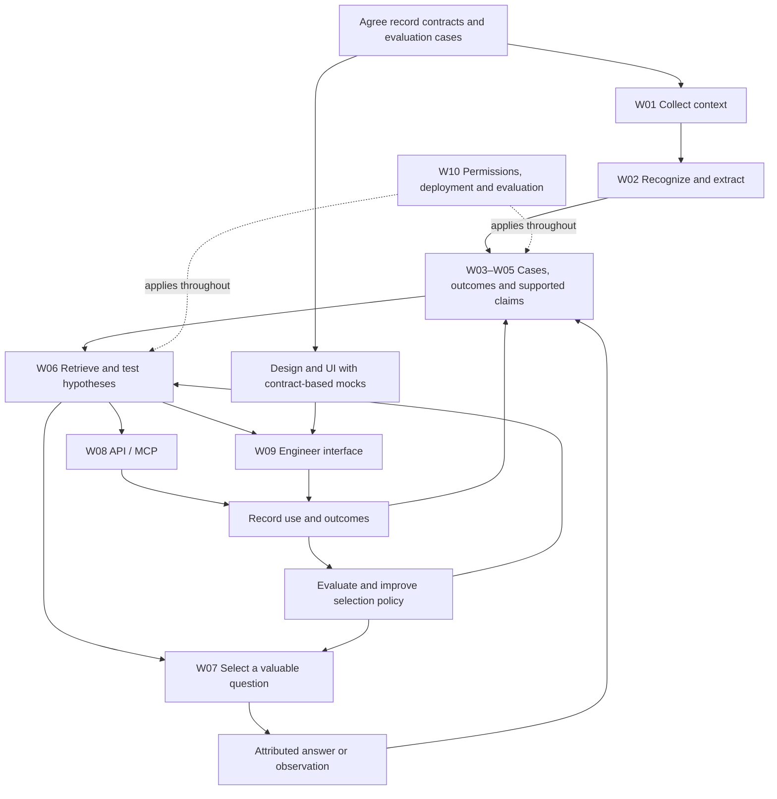

# Knowledge Twin — workstreams and delegation plan

**Since AI Hackathon · Elisa challenge · 6 November 2026**

This document divides the current vision into explainable problems and bounded implementation assignments. It is a planning document: the architecture and static avatar are documented, while the ingestion pipeline, trained policy, MCP service and packaged desktop app are still to be built.

Read the [full vision](../README.md), [architecture reference](ARCHITECTURE.md), [interactive master map](master-map.html) and [engineering decision queue](ENGINEERING_DECISIONS.md) for deeper detail.

For a fresh planning session, use the [technical discussion guide](TECHNICAL_DISCUSSIONS.md), which preserves the latest questions about Yes/No verification, recommendation thresholds and assistant delegation.

## 1. The idea in one sentence

> We turn existing conversations into reusable operational knowledge, ask experts only for consequential missing details, and deliver the right context when an engineer or agent needs it.

The core fits the supplied Elisa brief: capture existing knowledge with minimal additional expert work, connect it to the right entity and validity period, and make it usable by an agent. The brief identifies usability as the primary criterion. Artem reports that the information session accepted quick Yes/No questions while discouraging forms and elaborate feedback.

Our assessment is that the core is coherent and potentially elegant, while the full feature list is broad. One shared memory serves engineers and agents, and one useful answer can improve future assistance. The prototype should demonstrate that loop before adding extensive connectors, clustering experiments, sequential RL or animation polish. This is a design assessment, not a prediction of judging results.

## 2. Ten problems, each in one sentence

| ID | Workstream | One-sentence problem | Concrete output |
| --- | --- | --- | --- |
| W01 | Collect context | How do we obtain relevant historical and new information from approved sources with minimal effort? | Importers feeding one common evidence format. |
| W02 | Recognize useful knowledge | How do we distinguish useful operational context from incidental conversation and describe it accurately? | Useful/uncertain/irrelevant classification and structured observations. |
| W03 | Form cases and patterns | How do we decide which fragments belong to one incident and which separate incidents share a recurring pattern? | Cases, timelines and reversible pattern memberships. |
| W04 | Connect responses and outcomes | How do we reconstruct what people tried, what happened, and under which conditions a response might help again? | Source-backed problem-to-response histories and reusable procedures. |
| W05 | Establish dependable claims | How do we represent support, contradictions, uncertainty and changing validity without treating repetition as proof? | Claim records, evidence relationships and applicability rules. |
| W06 | Recommend and test hypotheses | How do we find relevant knowledge, predict distinguishing traits, and decide whether to suggest, check further or abstain? | An investigation service with explicit candidate explanations and checks. |
| W07 | Ask and learn efficiently | How do we choose a valuable question, a suitable engineer and appropriate timing while learning from the result? | Question coordinator, feedback records and an evaluated selection policy. |
| W08 | Serve autonomous workflows | How do we let other agents retrieve and contribute qualified knowledge through a stable interface? | API/MCP contracts with sources, conditions, permissions and outcome reporting. |
| W09 | Create the engineer experience | How do we make contributing and receiving help quick, understandable and pleasant? | Electron interface, pixel avatar, motion system and expandable evidence history. |
| W10 | Operate and measure responsibly | How do we deploy on the organization's infrastructure and demonstrate useful results without excessive burden or data exposure? | Deployment configuration, access controls, evaluation fixtures and metrics. |

These are work boundaries, not a requirement for ten microservices or ten agents.

## 3. Clarify the objects before splitting implementation

- **Evidence:** an allowed source item or passage, with provenance, time and access scope.
- **Claim:** a typed assertion extracted from evidence, with support, contradictions, applicability and validity.
- **Case:** one incident, containing its observations, hypotheses, actions and outcomes.
- **Pattern/cluster:** a proposed relationship among separate incidents; similarity does not establish a shared cause.
- **Procedure:** a reusable response with preconditions, source support and outcome verification requirements.
- **Query:** the current problem or information need used to retrieve candidates.
- **Question:** a scoped request for a missing observation, relationship, condition or outcome.
- **Feedback:** an attributed response about a particular question or decision.

Cases, clusters and queries are different objects. Solutions connect through applicability conditions and outcomes; they are not one permanent answer attached to an embedding cluster.

Usefulness and truth are also different judgments. A speculative diagnosis may be worth preserving while unconfirmed. A site-key location can be useful without belonging to a fault incident. W02 should recognize operational knowledge, not only detect descriptions of problems. W05 evaluates what the evidence supports.

## 4. Boundaries and first acceptance checks

| Workstream | First prototype boundary | A useful acceptance check |
| --- | --- | --- |
| W01 | Supplied chat/email files, pasted text and one image route. Keep continuous capture as a separate extension. | Reimporting the same material preserves provenance without duplicating evidence or credit. |
| W02 | Context-aware classification and structured extraction, preserving original text and uncertainty. | A short reply is interpreted with its conversation; an access fact is retained; dinner chatter is not treated as a fault. |
| W03 | Exact identifiers and contextual candidate matching before sophisticated clustering. | One incident continued across channels is linked; a similar incident on another date remains separate. |
| W04 | Record attempts and reported/observed outcomes with source references. | A restart followed by recurrence remains a temporary workaround, not a lasting fix. |
| W05 | Explicit support, conflict and time/applicability states with source dependencies. | Five copies of one report do not count as five independent confirmations; a correction updates dependent views. |
| W06 | Hybrid retrieval, explicit applicability checks and predictions of additional traits. | A held-out recurrence retrieves useful context; a lookalike with conflicting conditions is qualified or rejected. |
| W07 | Shared coordinator with eligible recipients, budgets, cooldowns and defer/no-question. | It avoids asking an already answered question and cancels a queued question when new evidence resolves it. |
| W08 | Thin interface over the same service used by the UI. | An authorized agent gets sources, conditions and missing checks in a structured response, then records an outcome against the decision ID. |
| W09 | Compact input, one small question and expandable history; static pixel avatar first. | An engineer can paste/drop a problem, inspect a result, defer a question and expand evidence without navigating a large dashboard. |
| W10 | One organization-controlled deployment configuration and a versioned evaluation set. | Report usefulness, errors, missed opportunities and effort together; verify restricted context stays restricted. |

## 5. Technical decisions to keep together

These decisions affect multiple workstreams and should be agreed by Artem and the architecture owner before separate agents make incompatible assumptions.

### Knowledge semantics and storage

- Claim types, source references and the granularity needed for meaningful verification.
- Equipment/person identity, aliases and cross-platform mappings.
- Event time, ingestion time, validity and unknown dates.
- Meaning of reported, corroborated, contradicted, superseded and confirmed for the intended workflow.
- Dependency propagation when a source changes, is deleted or becomes inaccessible.
- Initial PostgreSQL tables and typed relationships; object storage for source material and embeddings for retrieval. RAG is a retrieval-and-generation method, not the database itself.

Related decisions: D01, D06, D09, D10, D14.

### Classification, linking and hypothesis testing

- Conversation windows and the labels used for relevance and interpretation.
- Same-incident linking versus same-pattern membership; costs of false merges and false splits.
- Embedding representation and exact entity/environment matching.
- What additional traits each hypothesis predicts and what would contradict it.
- What triggers a recommendation, a further check or abstention.

Related decisions: D02–D08, D11.

### Question policy and learning

- The action is a question–recipient–timing choice, including defer/no-question.
- Eligible recipients depend on access, case participation, likely firsthand knowledge and workload.
- A factual Yes/No updates evidence; recommendation helpfulness labels decision utility. Either factual answer can make a question valuable.
- Define question value through consequential new evidence or better decisions, not merely agreement or reduced model self-confidence.
- Start with a transparent baseline; evaluate a contextual bandit for selection when logs support it. Consider sequential RL when a multi-step policy can demonstrate added value.
- Define reward components, missing-feedback handling, delayed credit and stopping rules before choosing a specific RL algorithm.
- Keep user points separate from the model reward and from factual credibility.

Related decisions: D12, D13, D18.

### Metrics and evaluation

- Supported useful assistance per eligible opportunity, with the opportunity population defined.
- Recommendation helpfulness with response coverage and reporter provenance.
- Unnecessary proactive interventions and missed useful opportunities.
- Expert questions, answering time and per-person load.
- Unsupported/inapplicable advice, false merges, stale claims and permission errors.
- Separate MCP exposure, agent-reported use, human-reported helpfulness and observed outcomes.
- Hold out scenario families and future outcomes; distinguish synthetic results from human evidence.

Related decisions: D13, D16. Metric definitions belong to the architecture discussion; an evaluation agent can implement the agreed measurements.

## 6. Bounded assignments for separate agents

These are delegation briefs, not a claim that agents have been launched. Assign ownership of files and interfaces before starting parallel implementation.

| Assignment | Prerequisite | Deliverable and completion condition |
| --- | --- | --- |
| Synthetic scenario author | Agreed labels, scenario format and split policy | Documented conversations plus separate scenario truth, covering chatter, access facts, temporary fixes, recurrence, contradictions and lookalikes. Keep evaluation families separate and do not expose future answers to inference. |
| Import/parser implementer | Agreed evidence envelope | Parsers for supplied chat/email formats, stable IDs, timestamps, provenance and idempotent reimport. No live-mailbox integration in this task. |
| Avatar/design/animation specialist | Artem's forthcoming visual direction and UI state list | White pixel-circle assets and animation proposals with preview/export conventions, reduced-motion behavior and state transitions. Backend and certainty semantics remain outside this assignment. |
| Electron interface implementer | Agreed view models and mock responses | Compact paste/drop input, question controls and expanded history; keep the same core workflow across intended macOS/Windows builds. Verify actual builds before claiming parity. |
| MCP adapter implementer | Agreed tool contracts and authorization behavior | Thin adapter against the shared service or a clearly labeled stub, preserving sources, conditions, errors and decision IDs. No alternate reasoning engine inside the adapter. |
| Evaluation harness implementer | Frozen metric definitions and controlled fixture access | Repeatable evaluation runner with counts, denominators, scenario slices and baseline comparisons. Do not tune on hidden test answers. |

The parser, UI mocks and design work can proceed in parallel after their contracts are settled. Semantic claims, support rules, question rewards and evaluation definitions should have a single coordinated owner.

For every assignment, provide: objective, owned files, inputs, output schema, examples, non-goals, completion checks and assumptions that require discussion. Use separate branches/worktrees when agents will modify overlapping areas; integration remains an explicit task.

## 7. Design and animation track

Electron is the current framework direction for the whole desktop application. The compact avatar and expanded case window are two views of the same service. The default avatar is a white pixel circle with small dark eyes, a tiny mouth and pink cheeks; see [the current asset](assets/avatar-default.svg).

Artem will provide further design and animation ideas. Agree on the intended character and motion before asking the design agent to produce a full animation set.

A starting application-state vocabulary is:

- Idle.
- Receiving input.
- Processing.
- Question available.
- Result available.
- Unavailable/error.

These are interface states. Claim uncertainty and evidence limitations remain explicit in text. Motion should support a quiet, responsive experience: clicking opens the input, questions can wait, and expanding reveals the complete available history. Include a reduced-motion option and evaluate idle resource use. Points remain optional and independently switchable.

## 8. Dependency order

Evidence updates and policy training run on different clocks. An answer can update memory immediately; model changes go through versioned training, evaluation and deployment.

## 9. First integrated milestone

Build one complete path before expanding the number of sources or algorithms:

1. Import the supplied synthetic conversation and email as representations of one incident.
2. Extract useful claims, attach sources and preserve uncertain conditions.
3. Reconstruct observations, the proposed check/action and the reported outcome without inventing missing verification.
4. Resolve one consequential gap through an existing source or a short engineer question.
5. Introduce a held-out similar incident and retrieve the relevant knowledge through MCP.
6. Check applicability and show which next decision changes because of the retrieved context.
7. Introduce a lookalike that should be rejected or qualified, and record the outcome.

The demonstration should include a supported path that works without a new human answer. A clarification should become reusable knowledge, not a mandatory approval button on every future incident. Label simulated telemetry, stub services and synthetic feedback clearly.

## 10. Pitch structure

Explain the ten engineering workstreams through three chapters:

1. **Capture:** existing conversations become useful, structured context without a separate documentation task.
2. **Establish trust:** sources, conditions, contradictions and small targeted clarifications make the context dependable.
3. **Reuse:** an engineer or agent receives applicable knowledge at the next decision, with less repeated expert effort.

Show one successful reuse, one misleading lookalike the system handles correctly, and one small clarification reused later. The avatar demonstrates low-friction interaction. Learning demonstrates improvement only when measured; collecting feedback alone does not establish a trained policy.

Mention the intended similar Electron workflow on macOS and Windows and organization-controlled deployment as practical advantages. Treat them as planned capabilities until implemented and validated.
